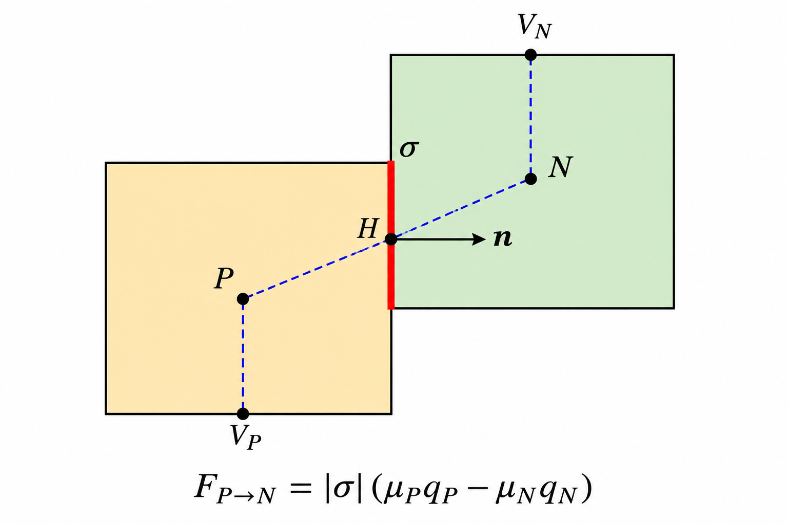

Пусть есть ячейка $P$, ячейка $N$ и грань $f$ между ними. Для неконформных ячеек $f$ — общая подгрань. $z$ — глубина, $\lambda_i$ — скалярная теплопроводность, $d_i$ — расстояние от центра $i$ до прямой грани по нормали. Плотность потока $q$ положительна из $P$ в $N$ (на внешней границе — наружу). **Поток через грань** $F=q\,|f|$, где $|f|$ — её длина.

### 1. Внутренняя вертикальная подгрань — MPFA-H

На рисунке $\sigma=f$, $P$ ниже $N$. Обозначим $\Delta=z_N-z_P$ и введём

$$
D=\lambda_N d_P+\lambda_P d_N,\qquad
G=\frac{\lambda_P\lambda_N}{D},\qquad
\mu_P=\frac{\lambda_N d_P}{D},\qquad
\mu_N=\frac{\lambda_P d_N}{D}.
$$

Гармоническая точка $H$ лежит на прямой $x=x_f$. При разных $\lambda$ она может отклоняться от отрезка $PN$. Вес температуры $N$ в $H$ равен $\mu_P$:

$$
z_H=z_P+\mu_P\Delta,\qquad T_H=T_P+\mu_P(T_N-T_P).
$$

Для $i=P,N$ точка $V_i$ лежит на горизонтальной грани столбца $i$ по другую сторону от $z_i$, чем $z_H$. Пусть $h_i=|z_{V_i}-z_i|$, $s_i=(T_i-T_{V_i})/h_i$. Односторонний поток **наружу** из $i$:

$$
q_i=\frac{\lambda_i}{d_i}\left[T_i-T_H+|z_H-z_i|\,s_i\right].
$$

Поскольку $(\lambda_P/d_P)\mu_P=(\lambda_N/d_N)\mu_N=G$, получаем

$$
q_P=G(T_P-T_N+|\Delta|s_P),\qquad
q_N=G(T_N-T_P+|\Delta|s_N).
$$

При $B_i=G\mu_i|\Delta|$ итоговая плотность потока

$$
\boxed{q=\mu_P q_P-\mu_N q_N=G(T_P-T_N)+B_P s_P-B_N s_N.}
$$

**Коэффициенты при температурах ячеек.** Запишем $s_i=a_iT_i-b_iT_{M_i}+e_i$, где $M_i$ — сосед через $V_i$, если он есть. На внешней грани член с $M_i$ опускается. $T_s$ и $q_b$ берутся в $V_i$, базальный поток $q_b$ положителен внутрь.

| Где лежит $V_i$ | Как получено $T_{V_i}$ | $a_i$ | $b_i$ | $e_i$ |
|---|---|---|---|---|
| Между $i$ и $M_i$, $h_M=\lvert z_{M_i}-z_{V_i}\rvert$ | $T_{V_i}=T_i+h_i k_i(T_{M_i}-T_i)$, $k_i=\lambda_{M_i}/(\lambda_i h_M+\lambda_{M_i}h_i)$ | $k_i$ | $k_i$ | $0$ |
| На верхней границе Дирихле | $T_{V_i}=T_s$ | $1/h_i$ | $0$ | $-T_s/h_i$ |
| На подошве с условием Неймана | $T_{V_i}=T_i+h_i q_b/\lambda_i$ | $0$ | $0$ | $-q_b/\lambda_i$ |

Подстановка для каждой стороны независимо даёт весь шаблон, включая граничные случаи:

$$
\boxed{q=(G+B_Pa_P)T_P-(G+B_Na_N)T_N
-B_P b_P T_{M_P}+B_N b_N T_{M_N}+B_P e_P-B_N e_N.}
$$

При $z_P=z_N$ обе поправки исчезают: $q=G(T_P-T_N)$.

### 2. Внутренняя горизонтальная грань

$P$ сверху, $N$ снизу. Из непрерывности потока через общую грань:

$$
q=\frac{\lambda_P}{d_P}(T_P-T_f)
 =\frac{\lambda_N}{d_N}(T_f-T_N)
\quad\Longrightarrow\quad
\boxed{q=\frac{\lambda_P\lambda_N}{\lambda_N d_P+\lambda_P d_N}(T_P-T_N).}
$$

### 3. Внешняя вертикальная грань

**Уступ поверхности, Дирихле.** $C$ — середина открытой подграни, $T_C=T_s(C)$. Вместо $H$ в односторонней формуле берётся $C$. Для $L=\lambda_P/d_P$, $B=L|z_C-z_P|$ и коэффициентов из таблицы:

$$
q=L(T_P-T_C)+B s_P
=\boxed{(L+B a_P)T_P-B b_P T_{M_P}+B e_P-LT_C.}
$$

**Левая или правая стенка, Нейман.** Задан входящий поток $q_{\rm side}$, поэтому $\boxed{q=-q_{\rm side}}$. По умолчанию $q=0$. В коде функция бокового потока вычисляется в центре $P$.

**Уступ подошвы, Нейман.** Базальный приток задан на горизонтальную проекцию. На вертикальном участке $|\operatorname{proj}_x f|=0$, поэтому $\boxed{q=0}$.

### 4. Внешняя горизонтальная грань

**Поверхность, Дирихле.** $C$ — середина грани, $T_C=T_s(C)$. Направление $PC$ нормально к грани:
$$
\boxed{q=\frac{\lambda_P}{d_P}(T_P-T_C).}
$$

**Подошва, Нейман.** $q_b(C)$ задан внутрь, $|\operatorname{proj}_x f|=|f|$, поэтому $\boxed{q=-q_b(C)}$.

### Источники

- Гармоническая точка $H$ и температура $T_H$ — [Agélas, Eymard, Herbin (2009), лемма 2.1, (2)–(3)](https://www.numdam.org/item/CRMATH_2009__347_11-12_673_0.pdf).
- Односторонние потоки, веса и граничные условия — [Contreras et al. (2016), (16), (18), (20)–(21), (28)–(29)](https://periodicos.unb.br/index.php/ripe/article/download/21699/20011).
- Реконструкция по направлениям с неотрицательными коэффициентами — Vassilevski et al., *Parallel Finite Volume Computation on General Meshes*, §2.3, (2.21)–(2.22), (2.32). Нелинейные веса для сравнения — §2.4, (2.44)–(2.45).
